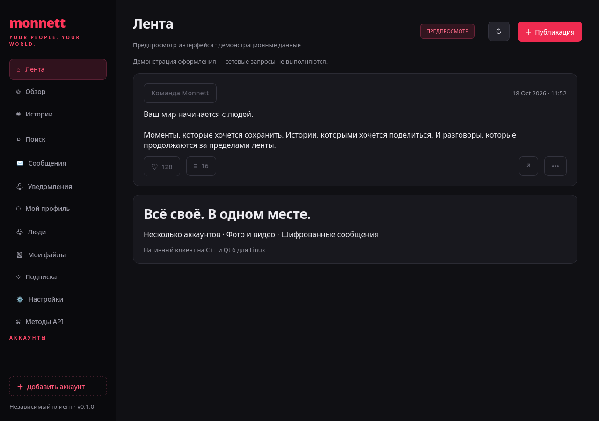

# Monnett для Linux

Независимый нативный клиент Monnett на **C++20 / Qt 6 Widgets**. Красно-чёрная тема, навигация слева, несколько аккаунтов, основной и тестовый серверы. Без админки и вебхуков.



## Возможности

- Вход, регистрация, подтверждение email и восстановление пароля через OTP.
- Несколько аккаунтов; отдельные JWT, refresh token и Matrix device ID для каждого. Один email на production и development считается двумя разными аккаунтами.
- Лента и Discover, пагинация, географические фильтры, поиск пользователей, постов и хэштегов.
- Профили, подписки, блокировки, списки связей и запросы подписки.
- Истории, отметки просмотра и зрители.
- Публикация текста, фото, видео и историй; аудитория и дополнительные поля API. Последовательная загрузка файлов, повтор загрузки в открытом окне, проверка статуса обработки.
- Лайки, комментарии и ответы, закрепление, репосты, редактирование и удаление своих постов, жалобы.
- Уведомления с фильтрами и отметкой прочтения, собственные медиа, тарифы, квоты, рефералы.
- Редактирование профиля, аватара, username и bio. Смена пароля и email.
- Matrix-переписка через **libQuotient с E2EE**: комнаты, история, текст, файлы, реакции, read markers, удаление сообщений, повтор неудачной отправки.
- **167 клиентских операций для каждой среды**: 165 из официальной OpenAPI и 2 дополнительных legacy-маршрута из реверса. Во вкладке «Методы API» доступны поиск, параметры пути и query, JSON тела, multipart-файлы, контракт с моделями и ответ, сохранение бинарного ответа в файл. Образец JSON содержит только обязательные поля; необязательные поля добавляются по контракту. Параметры-массивы query вводятся как JSON и передаются повторяющимися ключами.

Редкие функции, включая OIDC с готовым ID token, дополнительные настройки алгоритма, локации, FCM и share-методы, доступны через каталог API. Они не имеют отдельных специализированных экранов. Каталог показывает, откуда получен контракт. [Полная матрица покрытия](docs/API_COVERAGE.md).

## Добавление аккаунтов

Обычный щелчок **«Добавить аккаунт»** внизу левого меню открывает вход на основной сервер.

Для аккаунта **тестового сервера** удерживайте **Shift + Alt** и нажмите **правую кнопку мыши** на той же кнопке. Откроется окно с заголовком «Аккаунт тестового сервера». Аккаунты dev помечаются `[DEV]`, а в заголовке страницы отображается тестовая среда.

Выбранная среда привязана к аккаунту; переключение аккаунта меняет REST-сервер и Matrix-сессию вместе.

## Сборка

Нужны CMake ≥ 3.24, Ninja, компилятор C++20, Qt ≥ 6.5 (Core, Gui, Widgets, Network, Multimedia, MultimediaWidgets, Test), libsecret, **libQuotient Qt6 ≥ 0.9.6**, QtKeychain и libolm. Для изображений рекомендуются Qt SVG и imageformats. Версии Qt и libQuotient должны быть совместимы по ABI; особенно это важно для Qt ≥ 6.10.

Arch Linux / Omarchy:

```sh
sudo pacman -S --needed base-devel cmake ninja qt6-base qt6-multimedia qt6-svg qt6-imageformats libsecret libquotient
./scripts/build.sh
./scripts/run.sh
```

Обычная сборка с системными зависимостями:

```sh
cmake -S . -B build -G Ninja -DCMAKE_BUILD_TYPE=Release -DBUILD_TESTING=ON
cmake --build build --parallel 2
ctest --test-dir build --output-on-failure
./build/monnett-qt
```

При установке зависимостей в собственный префикс передайте `-DCMAKE_PREFIX_PATH=/path/to/prefix`. `scripts/build.sh` и `scripts/run.sh` также распознают локальный префикс `~/.local/share/monnett-qt-deps/usr`, использованный для первоначальной сборки на этой машине.

Установка в меню приложений:

```sh
cmake --install build --prefix "$HOME/.local"
```

Для установки собранного клиента с локальными библиотеками без root используйте `./scripts/install-local.sh`. Команда `monnett-qt` и пункт меню приложений будут установлены в `~/.local`.

Для Arch есть [PKGBUILD](packaging/PKGBUILD). CI собирает проект в актуальном Arch Linux и запускает тесты с offscreen-платформой Qt.

## Данные и сессии

JWT и refresh token сохраняются через **Secret Service** (GNOME Keyring / KeePassXC Secret Service и другие совместимые провайдеры). В QSettings находятся только метаданные аккаунтов. Если хранилище недоступно, сессия работает в памяти и после перезапуска потребуется повторный вход. Пароли не сохраняются. Поля токенов в просмотре JSON скрыты.

Обычный каталог настроек: `~/.config/MonnettQt/monnett-qt.conf`. Криптобаза, ключи и кэш Matrix обслуживаются libQuotient и QtKeychain. Кнопка локального удаления удаляет Monnett-токены из Secret Service; это не удаление аккаунта на сервере и не стирание криптобазы SDK. Настройки «Выйти» и «Удалить аккаунт на сервере» — разные действия.

Запросы выполняются асинхронно. Refresh объединяется для параллельных 401; refresh body передаётся JSON-строкой, как в документации. Сетевые ошибки изменяющих запросов не повторяются автоматически. Multipart timeout — 300 секунд. Ответы и параметры сервера не записываются в журналы приложения.

## Проверки и границы

Сборка и тесты проверены локально на Qt 6.11.2 / libQuotient 0.9.6.1. Тестовый HTTP-сервер проверяет URL, заголовки, JSON-строку refresh, конкурентные 401, multipart, отсутствие автоматических повторов записи и отмену callback после закрытия экрана. Тесты интерфейса проверяют секретный жест, режимы входа и построение всех 167 форм. Отдельно проверяются сценарии публикации и экранов на синтетических ответах. Доступность обеих сред проверена через `/api/_health`.

**Живые вход, публикация и обмен шифрованными сообщениями не проверялись: для них нужен пользовательский аккаунт.** Реверс не гарантирует доступность legacy-маршрутов; HTTP-ошибки и бизнес-лимиты показываются в интерфейсе. Отправка после сетевого обрыва может иметь неизвестный результат — перед повторным созданием поста проверьте профиль. Продолжение загрузки сохраняется только пока открыто окно публикации.

E2EE выполняет SDK. На новом устройстве старые сообщения могут оставаться недоступны без ключей. Отдельного интерфейса cross-signing, проверки устройств и восстановления key backup в этой версии нет; клиент показывает отсутствие ключа и не подменяет шифрованную отправку открытым текстом. Настольного FCM push и покупки подписки через мобильный магазин нет; соответствующие REST-операции доступны в каталоге.

Предпросмотр оформления без аккаунта и сетевых запросов:

```sh
./scripts/run.sh --preview
QT_QPA_PLATFORM=offscreen ./scripts/run.sh --preview --screenshot preview.png
```

## Контракты API

Использованы `~/monnett-api-reverse/Monnett_API_1.5.0.md`, его машиночитаемый OpenAPI и официальные спецификации:

- [Основной сервер](https://api.monnettsocial.com/openapi.json)
- [Тестовый сервер](https://api-dev.monnettsocial.com/openapi.json)

В репозитории сохранены только клиентские части контрактов и достижимые из них схемы. Admin, webhooks и служебный JobRunr не входят в клиент. На момент получения обе официальные спецификации совпадали. Источники и SHA-256 исходных ответов находятся в `resources/catalogue.json`.

Обновление:

```sh
python tools/update_api.py --reverse ~/monnett-api-reverse/docs/openapi.json
```

Скрипт не требует серверных ключей или аккаунта. [Особенности контрактов](docs/CONTRACT_NOTES.md).

Клиент не является официальным продуктом Monnett. Код — MIT; зависимости и опубликованные сервисом контракты сохраняют собственные условия использования.
